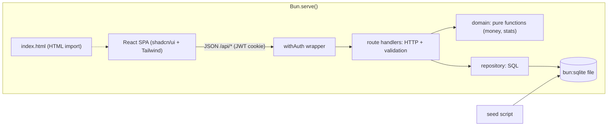

# Salary Management Tool

A web app for ACME's HR manager to manage salaries for about 10,000 employees across countries, and to answer questions about how the org pays people.

## Run it

**Docker** (no Bun needed):

```sh
cp .env.example .env      # then set JWT_SECRET, ADMIN_EMAIL, ADMIN_PASSWORD
docker compose up --build # http://localhost:3000
```

**Local dev** (Bun 1.4.3):

```sh
bun install
bun dev                   # API on :3000, web on http://localhost:5173 (proxies /api)
bun run check             # lint, typecheck, test, build, audit
```

All commands: [devops.md](docs/devops.md#commands).

## Architecture



Server and web are separate Bun workspaces ([ADR-005](docs/adrs/005-separate-web-and-api-packages.md)) and share only `packages/shared/` (API types and money helpers).

## Docs

| Doc | Purpose |
|-----|---------|
| [requirements.md](docs/requirements.md) | The problem, what the HR manager needs, scope, and what's left out and why |
| [development-process.md](docs/development-process.md) | Core rules for every area: TDD, slicing, clean code, shared conventions, commits, definition of done |
| [frontend.md](docs/frontend.md) | Web stack, folder layout, import rules, testing, and design rules |
| [backend.md](docs/backend.md) | Server stack, architecture, folder layout, database, testing, performance |
| [devops.md](docs/devops.md) | Commands, env vars, Docker Compose, deployment |
| [adrs/](docs/adrs/) | Significant decisions, with the alternatives considered |
| [specs/](docs/specs/) | Per feature: acceptance criteria (what) |
| [plans/](docs/plans/) | Per feature: slices, contract, backend and frontend tasks, test list (how) |
| [ai-log.md](docs/ai-log.md) | How AI was used and where I overrode it |
